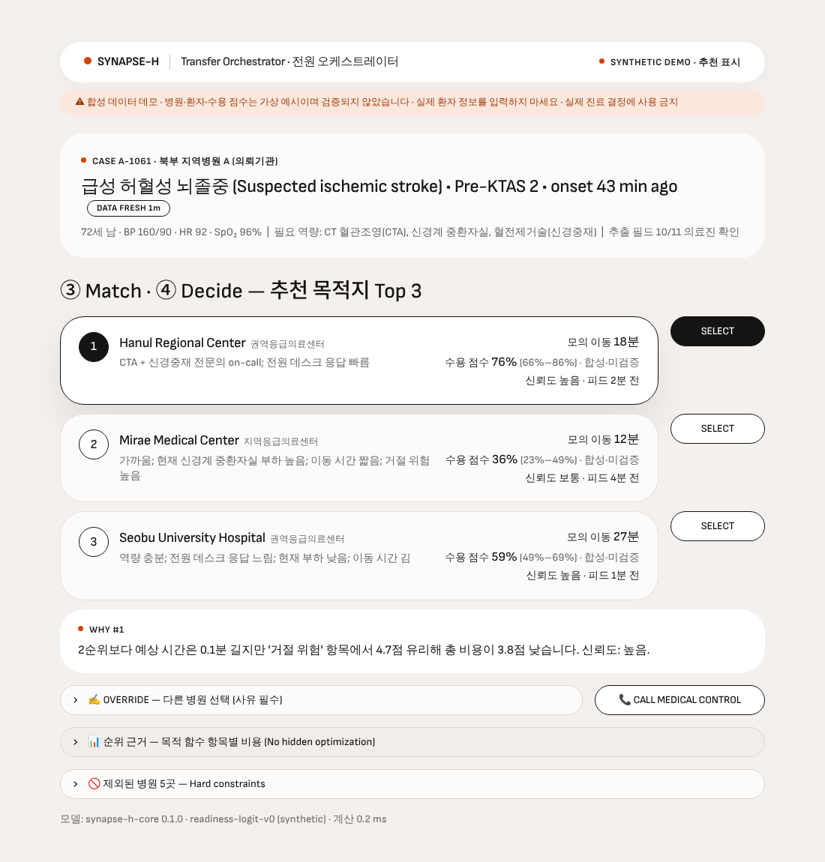
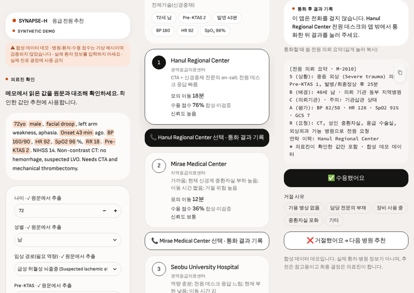

# SYNAPSE-H · 응급 전원 의사결정 지원 (합성 데이터 프로토타입)

**병원 간 응급 전원에서 "어느 병원에 먼저 연락할지"를 정리해 주는 사람 감독형 의사결정 지원 프로토타입입니다.**
의뢰 메모를 구조화하고(의료진 확인 필수), 필요한 진료 역량이 있는 병원만 남긴 뒤, 이동 시간·승인 지연·거절 위험·
병원 부하·데이터 불확실성을 함께 고려해 **설명 가능한 상위 3개 후보**를 보여 줍니다. 최종 결정과 연락은 사람이 합니다.

> ⚠️ **합성 데이터 데모입니다.** 병원·환자·수용 점수는 모두 가상 예시이며 실제 병원 데이터로 검증되지 않았습니다.
> 실제 환자 정보를 입력하거나 실제 진료 결정에 사용하지 마세요.

- **Live demo:** [웹 앱 (8개 화면)](https://hermesnode.streamlit.app/) · [모바일·태블릿 앱](https://synapse-h-mobile.streamlit.app/) — 한동안 접속이 없으면 잠들어 있으니 깨우기 버튼을 누르고 30초쯤 기다리세요
- **사업계획서:** IYEO 2026 University Division, SYNAPSE-H Business Proposal (Hyeonwoo An)
- **문서:** [프로젝트 요약 (3분)](docs/PROJECT_SUMMARY.md) · [아키텍처·데이터 경계](docs/ARCHITECTURE.md) · [기술 의사결정 기록](docs/DECISIONS.md) ·
  [현장 사용성 검증 계획](docs/VALIDATION_PLAN.md) · [규제 자가 점검 초안](docs/REGULATORY_ASSESSMENT.md) · [사업계획서 수정안](docs/PROPOSAL_REVISIONS.md)

| 웹 앱 — 전원 오케스트레이터 | 모바일 앱 — 확인 → 추천 → 통화 결과 기록 |
|---|---|
|  |  |

## 1. 해결하려는 문제

이미 전원이 필요하다고 판단된 환자를 받을 수 있는 상급병원을 찾는 과정은 대부분 순차 전화 탐색입니다.
국가응급의료상황실의 2017–2019년 전원 조정 요청 10,222건을 분석한 연구에서 81.2%가 조정에 성공했고, 요청 사유는
의료인력 부족(59.8%)과 중환자실 병상 부족(30.8%)이 대부분이었으며, 지연은 병원 자원 부족과 연관되었습니다
([BMC Emergency Medicine, 2023, doi:10.1186/s12873-023-00782-1](https://doi.org/10.1186/s12873-023-00782-1)).
이 프로젝트는 그중 **정보 정리와 연락 순서**에서 생기는 지연을 줄이는 것을 목표로 하며, 병상·인력 부족 자체는
해결하지 못한다는 점을 전제로 합니다.

## 2. 현재 상태 — 구현 · 시뮬레이션 · 미구현

| 구분 | 기능 | 상태 |
|---|---|---|
| ✅ 구현 | 의뢰 메모 → 구조화 필드 추출 (근거 원문 표시, 범위 검사, 부정·과거력·경로 충돌 처리) | 규칙 기반 기본 |
| ✅ 구현 | **LLM 추출기** (Claude 기본·GPT 선택): 근거 원문이 메모에 있고 숫자가 맞을 때만 채택, 규칙 기반과 다르면 사람에게 물음, 실패 시 규칙 기반으로 대체, 식별정보 형식이면 전송 차단 | API 키가 있을 때만 켜짐 · 정확도 실측은 키 설정 후 (아래 §5) |
| ✅ 구현 | 의료진 확인 후에만 추천 실행 (웹·모바일 모두) | |
| ✅ 구현 | 필수 역량·병상·피드 신선도 하드 제약, Top 3 순위와 근거, 의료지도 에스컬레이션 | |
| ✅ 구현 | 고위험 환자 이동 가드레일 → 경고가 아니라 의료지도 확인으로 에스컬레이션 | 임계값은 임상 검토 전 placeholder |
| ✅ 구현 | 여러 환자 동시 배정 (병상 용량·쏠림 벌점, 헝가리안 알고리즘) | |
| ✅ 구현 | 연락 결과 기록, 거절 시 재추천, 전원 의뢰 요약(SBAR) 생성 | 실제 전화·병원 시스템 연결 없음 |
| ✅ 구현 | **공공 응급의료 API 연동** (국립중앙의료원: 응급실 가용 병상, CT·MRI, 중증질환 수용 정보, 좌표) | 서비스 키 필요. 없으면 같은 형식의 합성 샘플로 미리보기. 수용률·응답 시간은 공공데이터에 없어 가정값으로 표시 |
| ✅ 구현 | **로그인·역할 분리** (조회 전용 / 전원 담당 / 감독자, PBKDF2 해시, 반복 실패 잠금) | 계정을 Secrets에 넣을 때만 켜짐. 없으면 공개 데모 |
| ✅ 구현 | **추가 전용 감사 로그** (SQLite, 수정·삭제 차단, 해시 체인 무결성 검사) | `AUDIT_DB_PATH` 설정 시. Streamlit Cloud 디스크는 재시작 시 초기화 |
| ✅ 구현 | 감사 지표 (첫 통화 수용률 / 모델 1순위 수용률 분리, 실측 시간 / 가정 시간 분리) | |
| ✅ 구현 | **FHIR R5 번들 + KR Core 1.0.2(R4) 번들**, HL7 공식 validator로 CI에서 검증 (예시 14건 오류 0) | 용어 서버 검증(-tx)은 제외. 기관 식별자(HIRA)·KCD-8 진단 코드가 필요한 자원은 프로파일을 주장하지 않음 |
| ✅ 구현 | 보정 점검·재학습 파이프라인 (Brier, 보정 기울기·절편, ECE, 시간순 분할, 경로별) | 실제 데이터가 없어 합성 기록으로 작동만 확인 |
| ✅ 구현 | 사용성 비교 연구 도구 (참여자 코드 기록, 기존 방식 관찰지와 비교 요약) | 연구 자체는 미실시 |
| 🧪 시뮬레이션 | 병원 네트워크(8곳), 이동 시간, 피드 지연 | 가상 지역 (공공 데이터 연동 시 실제 병원 목록) |
| 🧪 시뮬레이션 | **수용 점수** — 합성 계수의 로지스틱 기준식 | 실제 수용 확률로 보정·검증되지 않음 |
| 🧪 시뮬레이션 | 디지털 트윈 (가장 가까운 병원 vs Synapse-H, 짝지은 2만 건 × 10 seed) | 정책은 관찰 가능한 정보만 사용 |
| ⬜ 미구현 | 병원 EMR·전원 시스템 연동, 실제 병원 데이터로 학습·보정한 모델 | 데이터·협약 필요 |
| ⬜ 미구현 | 현장 사용성 연구 실시, 임상 검증, 식약처 분류 결정 | [검증 계획](docs/VALIDATION_PLAN.md) · [규제 자가 점검 초안](docs/REGULATORY_ASSESSMENT.md) |

## 3. 추천 방식

1. **확인:** 메모에서 읽은 값은 의료진이 원문과 대조해 확인해야 추천에 쓰입니다. 부정 표현("뇌졸중 배제", "no facial droop"),
   과거력("history of stroke"), 경로 충돌, 비율로 적힌 SpO₂(0.96), 불명확한 발병 시각은 자동 판단하지 않고 사람에게 묻습니다.
2. **하드 제약:** 필요한 진료 역량이 없거나, 병상이 없거나, 피드가 60분 넘게 갱신되지 않은 병원은 거리와 무관하게 제외합니다.
3. **비용 순위:** `이동 시간 + 승인 지연 + (1 − 수용 점수) × 재탐색 비용 + 병원 부하 + 불확실성` (분 단위 환산, 가중치 조절 가능).
4. **안전 규칙:** 받을 병원이 없거나, 1순위 신뢰도가 낮거나, 고위험 환자(Pre-KTAS ≤ 2)의 1순위가 가장 가까운 적합 병원보다
   10분 넘게 멀면 의료지도 확인으로 에스컬레이션합니다.
5. **동시 배정:** 병원을 병상 슬롯으로 펼치고, 같은 병원에 몰릴수록 벌점을 더해 모든 환자 비용 합이 최소인 조합을 찾습니다.
   중증도가 높은 환자의 지연을 더 무겁게 계산합니다.

선택 이유와 한계는 [기술 의사결정 기록](docs/DECISIONS.md)에 정리했습니다.

## 4. 합성 디지털 트윈 결과

`python scripts/run_twin_experiment.py`로 재현됩니다. 실행 환경과 파라미터는 [`results/twin_baseline.json`](results/twin_baseline.json)에 저장됩니다.
Synapse-H 정책은 앱이 관찰할 수 있는 정보(과거 수용률, 오래될 수 있는 보고 부하)만 앱과 같은 기준식으로 사용하며,
실제 수용을 좌우하는 지역 혼잡 충격과 설명되지 않는 변동은 볼 수 없습니다.

| 지표 (2만 짝지은 에피소드) | 가장 가까운 적합 병원 | Synapse-H | 차이 (10 seed, 95% CI) |
|---|---|---|---|
| 1순위 수용률 | 64.1% | 69.9% | +5.5%p [+5.3, +5.7] |
| 평균 승인 시간 | 6.77분 | 6.31분 | −0.45분 [−0.46, −0.43] |
| 평균 이송 시간 | 16.50분 | 16.82분 | +0.31분 [+0.31, +0.31] |

거절 위험을 줄이는 대신 이송 시간이 조금 늘어나는 교환 관계입니다. 전체 표: [`results/twin_baseline.md`](results/twin_baseline.md)

이 결과는 계산적 타당성만 보여 줍니다. 사망률·임상 효과·실제 병원 행태를 추정하지 않으며, 신뢰구간은 시뮬레이션 난수 변동만
반영합니다. 사업계획서 v2의 Table 9에는 이 결과를 반영했습니다.

## 5. 테스트와 품질 검증

```bash
pip install -r requirements-dev.txt
pytest --cov=synapse_h          # 엔진 테스트 + 커버리지
python -m pyflakes synapse_h app tests scripts application_mobile.py
```

GitHub Actions가 push·PR마다 Python 3.12/3.13에서 린트, 테스트 66개(커버리지 90% 미만이면 실패), 트윈 재현,
추출기 비교, 보정 파이프라인을 실행하고, 별도 작업에서 HL7 공식 FHIR validator로 R5 번들과 KR Core 1.0.2(R4) 번들을 검증합니다.
테스트가 다루는 실패 상황: 필수 항목 누락, 범위 밖 값, 부정·과거력·경로 충돌, 피드 지연·확인 불가 피드, 받을 병원 없음,
모든 후보 거절 후 재추천, 병상 용량 초과 방지, 고위험 환자 가드레일, FHIR 참조 오류, 지표 계산(미해결 케이스 포함),
LLM이 원문에 없는 근거·틀린 숫자를 낸 경우, LLM 거절·응답 오류, 식별정보가 든 메모, 공공데이터의 '정보미제공'·인증 오류,
권한 없는 기능 사용, 반복 로그인 실패, 감사 로그 수정·삭제 시도와 파일 변조.

**추출기 비교** (`python scripts/compare_extractors.py`, 합성 메모 40건 × 필수 8개 필드):

| 메모 | 규칙 기반 정답 | 잘못된 값 제안 | 비워 둠 (사람이 입력) |
|---|---|---|---|
| 규칙과 함께 만든 30건 | 99.2% | 0 | 2 |
| 표현을 바꾼 10건 | 71.2% | 0 | 23 |

규칙 기반은 틀린 값을 내지 않는 대신, 처음 보는 표현에서는 많이 비워 둡니다. LLM 추출기는 API 키를 넣고
`--llm`으로 같은 표에 추가해 측정합니다 (아직 측정하지 않았습니다).

## 6. 실행

Python 3.12 이상, 저장소 최상위 폴더에서 실행하세요. 의존성 버전은 배포 환경과 같게 고정되어 있습니다.

```bash
python3 -m venv .venv && source .venv/bin/activate    # Windows: python -m venv .venv; .venv\Scripts\Activate.ps1
pip install -r requirements.txt
streamlit run app/streamlit_app.py        # 웹 앱 (8개 화면)
streamlit run application_mobile.py       # 모바일·태블릿 앱 (설정 없는 한 화면)
```

Streamlit Community Cloud 배포: share.streamlit.io → Create app → 저장소 `main`, Main file path에
`app/streamlit_app.py` 또는 `application_mobile.py`. 리뷰어가 볼 수 있게 하려면 앱 **Share** 설정을 Public으로 두세요.

**선택 기능은 Secrets로 켭니다** ([`.streamlit/secrets.toml.example`](.streamlit/secrets.toml.example) 참고, 실제 파일은 커밋하지 않음).
아무것도 넣지 않으면 지금처럼 키 없는 공개 합성 데모입니다.

| 기능 | 넣을 값 |
|---|---|
| LLM 추출기 | `ANTHROPIC_API_KEY` (또는 `LLM_PROVIDER="openai"` + `OPENAI_API_KEY`, `OPENAI_MODEL`) |
| 공공 응급의료 데이터 | `DATA_GO_KR_SERVICE_KEY` (data.go.kr 활용 신청 후 Decoding 키) |
| 로그인·역할 | `[auth.users.<아이디>]` 아래 `name`, `role`, `password_hash` (`python scripts/make_password_hash.py`로 생성) |
| 영구 감사 로그 | `AUDIT_DB_PATH` (SQLite 파일 경로) |

## 7. 저장소 구조

| 경로 | 내용 |
|---|---|
| `synapse_h/intake.py` | 구조화 추출, 범위 검증, 부정·과거력·충돌 처리, 의료진 확인 후 케이스 생성 |
| `synapse_h/llm.py`, `synapse_h/llm_intake.py` | LLM 호출 단일 진입점(Claude·GPT), LLM 추출기와 원문·규칙 교차 검증 |
| `synapse_h/intake_eval.py`, `evals/intake_notes.json` | 추출기 평가용 합성 메모와 채점 |
| `synapse_h/capabilities.py` | 임상 경로별 필수 역량 (하드 제약) |
| `synapse_h/readiness.py` | 수용 점수 기준식(합성 계수), 피드 신선도 가중, 신뢰도 라벨 |
| `synapse_h/optimizer.py` | 순위·근거·안전 규칙·에스컬레이션, 다중 환자 전역 배정 |
| `synapse_h/audit.py` | 감사 이벤트와 지표 (실측 / 가정 분리) |
| `synapse_h/audit_store.py`, `synapse_h/auth.py` | 추가 전용 SQLite 감사 저장소(해시 체인), 계정·역할·권한 |
| `synapse_h/public_feed.py` | 국립중앙의료원 응급의료 OpenAPI 연동과 병원 데이터 변환 (`samples/`에 합성 응답) |
| `synapse_h/handoff.py` | 전원 의뢰 요약(SBAR) |
| `synapse_h/fhir.py` | FHIR R5 번들, KR Core 1.0.2(R4) 번들, 구조 자체 점검, R5 스키마 검증 |
| `synapse_h/calibration.py`, `synapse_h/usability.py` | 수용 점수 보정 점검·재학습, 사용성 연구 요약 |
| `synapse_h/twin.py` | 디지털 트윈, 민감도 분석, 반복 실험 신뢰구간 |
| `synapse_h/finance.py` | 사업계획 매출 역산, 월별 현금 연결표 |
| `app/` | 웹 앱 (개요, 오케스트레이터, 지역 상황실, 동시 배정, 공공 데이터 연동, 트윈, 감사, 사업 모델) |
| `application_mobile.py` | 모바일·태블릿 앱 |
| `scripts/` | 트윈 재현, 추출기 비교, 보정 점검, 사용성 분석, FHIR 예시 내보내기, 비밀번호 해시 생성 |

## 8. 역할 분담과 주요 판단

개인 프로젝트입니다.

- **직접 한 일:** 문제 정의, 사업계획서, 요구사항, 설계 결정, 검증 기준 설정, 결과 검토
- **AI 코딩 도구(Claude Code)에 맡긴 일:** 코드 구현. 모든 동작은 자동 테스트 66개와 CI로 확인합니다.

**제가 내린 주요 판단**

- 설정 없는 모바일 앱을 만들면서 빠졌던 **의료진 확인 단계를 안전 원칙에 따라 되살림** — 추출 결과가 확인 없이 추천으로 가는 경로를 없앰
- 외부 검토를 받아 **지표 정의를 바로잡음** — 첫 통화 수용률과 모델 1순위 수용률을 분리하고, 실측 시간과 가정 시간을 분리
- **시뮬레이션의 정보 누수를 고침** — 예측기가 실제로는 알 수 없는 값을 보던 문제를 고치자 성능이 +6.3%p에서 +5.5%p로 낮아졌지만, 재현 가능한 수치를 택함
- 실제 데이터 없이 **"확률"이라고 부르지 않기로 함** — 화면·로그·문서 모두 "수용 점수(미검증)"로 통일
- 고위험 환자의 원거리 배정을 **경고가 아니라 의료지도 확인으로 넘기도록** 안전 규칙을 강화
- **LLM 결과를 그대로 믿지 않도록 함** — 근거 원문이 메모에 있어야 하고, 규칙 기반과 다르면 사람이 고르며, 실패하면 규칙 기반으로 돌아감
- 공공데이터에 없는 값(수용률·응답 시간·외상센터 지정)을 **가정값이라고 화면에 표시**하고, '정보미제공'은 없는 것으로 처리
