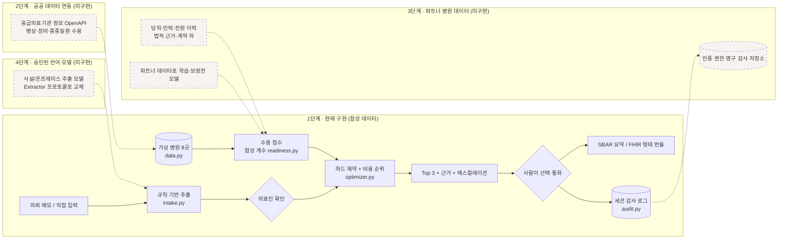

# 아키텍처와 데이터 경계

현재 저장소는 **1단계(합성 데이터 프로토타입)** 입니다. 아래 그림의 점선 박스는 아직 없는 부분입니다.

## 단계별 경계

| 단계 | 들어오는 데이터 | 바뀌는 모듈 | 전제 조건 | 현재 |
|---|---|---|---|---|
| 1. 합성 프로토타입 | 가상 병원·시나리오 | 전체 | 실제 환자 정보 입력 금지 | ✅ |
| 2. 공공 데이터 | 응급의료기관 정보 OpenAPI (병상·수술실·CT/MRI·중증질환 수용) | `data.py` → API 어댑터, 출처·갱신 시각 보존 | API 이용 승인, 갱신 주기 확인 | ⬜ |
| 3. 파트너 병원 데이터 | 비식별 전원 이력, 수용·거절 기록, 당직 정보 | `readiness.py` 재학습·보정, `audit.py` 영구 저장 | 데이터 제공 계약, IRB, 개인정보 영향평가 | ⬜ |
| 4. 승인된 추출 모델 | 실제 의뢰서 | `intake.py`의 `Extractor` 구현 교체 | 사설/온프레미스 추론, 필드 정확도 검증 | ⬜ |
| 5. 실제 사용 | 실시간 운영 | 인증·권한·SLA·모니터링 | 섀도 모드 결과, 규제 분류 결정 | ⬜ |

## 모듈 경계 원칙

- **엔진(`synapse_h/`)은 화면을 모릅니다.** 웹 앱과 모바일 앱은 같은 엔진을 호출하며, 테스트는 엔진만으로 실행됩니다.
- **사람의 확인이 경계입니다.** `build_case()`는 확인된 값만 받고 모든 범위를 다시 검사합니다. 추출 결과가 곧바로 순위로 가는 경로는 없습니다.
- **측정과 가정을 섞지 않습니다.** 감사 지표는 기록 시각으로 측정한 값과 트윈의 3분/6분 가정값을 별도 필드로 냅니다.
- **표준 연동은 "형태"까지만 주장합니다.** `fhir.py`는 R5 형태 번들과 구조 자체 점검만 제공합니다. 실제 연동 전에는
  공식 FHIR validator, 한국보건의료정보원의 KR Core 프로파일·용어 체계, 상대 기관의 구현 가이드로 검증해야 합니다.
