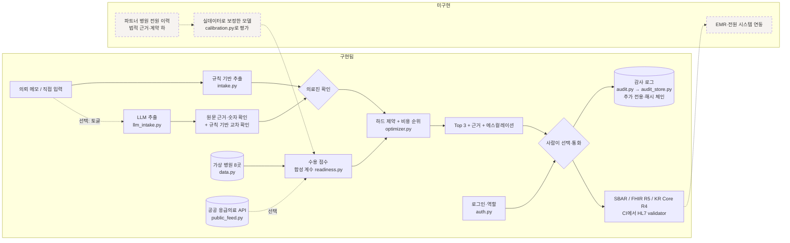

# 아키텍처와 데이터 경계

현재 저장소는 **1단계(합성 데이터 프로토타입)** 에 2단계 도구(공공 데이터, 계정, 영구 감사, 표준 검증)를 더한 상태입니다.
선택 기능은 배포 Secrets에 키·계정을 넣을 때만 켜집니다. 점선 박스는 아직 없는 부분입니다.

## 단계별 경계

| 단계 | 들어오는 데이터 | 바뀌는 모듈 | 전제 조건 | 현재 |
|---|---|---|---|---|
| 1. 합성 프로토타입 | 가상 병원·시나리오 | 전체 | 실제 환자 정보 입력 금지 | ✅ |
| 2. 공공 데이터 | 국립중앙의료원 OpenAPI (응급실 병상·수술실·중환자실·CT/MRI·중증질환 수용·좌표) | `public_feed.py`가 병원 목록을 만들고 출처·갱신 시각·가정값을 함께 보존 | 서비스 키, 외상센터 등 API에 없는 지정 목록 | ✅ 연동 코드 · ⬜ 실제 키로 지역 확인 |
| 2. 계정·감사 | 의료진 계정 | `auth.py`, `audit_store.py` | 계정은 Secrets에만, 영구 DB 위치 | ✅ (호스팅 DB는 운영 단계) |
| 2. 표준 | 확인된 케이스 | `fhir.py` (R5, KR Core 1.0.2) | CI의 HL7 validator | ✅ 구조·프로파일 · ⬜ 용어 서버·기관 구현 가이드 |
| 3. 파트너 병원 데이터 | 비식별 전원 이력, 수용·거절 기록, 당직 정보 | `calibration.py`로 평가 후 `readiness.py` 계수 교체 | 데이터 제공 계약, IRB, 개인정보 영향평가 | ⬜ (파이프라인은 준비됨) |
| 4. 추출 모델 | 실제 의뢰서 | `llm_intake.py` (같은 스키마) | 승인된 사설/온프레미스 추론, 필드 정확도 검증 | ◐ 상용 API로 합성 메모만 |
| 5. 실제 사용 | 실시간 운영 | 인증·권한·SLA·모니터링 | 섀도 모드 결과, 규제 분류 결정 | ⬜ |

## 모듈 경계 원칙

- **엔진(`synapse_h/`)은 화면을 모릅니다.** 웹 앱과 모바일 앱은 같은 엔진을 호출하며, 테스트는 엔진만으로 실행됩니다.
- **사람의 확인이 경계입니다.** `build_case()`는 확인된 값만 받고 모든 범위를 다시 검사합니다. 추출 결과가 곧바로 순위로 가는 경로는 없습니다.
- **측정과 가정을 섞지 않습니다.** 감사 지표는 기록 시각으로 측정한 값과 트윈의 3분/6분 가정값을 별도 필드로 냅니다.
- **표준은 검증한 만큼만 주장합니다.** 예시 번들은 CI에서 HL7 공식 validator로 FHIR R5와 KR Core 1.0.2(R4) 프로파일을
  통과합니다. 용어 서버 검증과 상대 기관의 구현 가이드 검증은 아직이고, HIRA 기관 식별자·KCD-8 진단 코드가 필요한
  Organization·Condition은 KR Core 프로파일을 주장하지 않습니다.
- **외부로 나가는 데이터는 최소화합니다.** LLM 추출은 사용자가 켤 때만, 식별정보 형식이 없는 메모만 보냅니다.
  공공데이터는 받기만 합니다.
